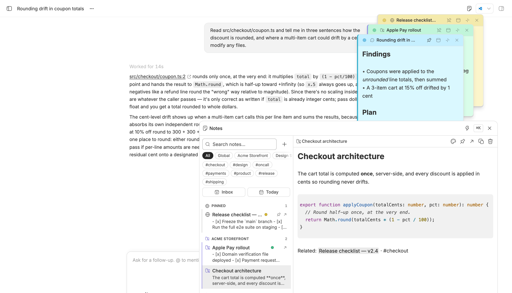
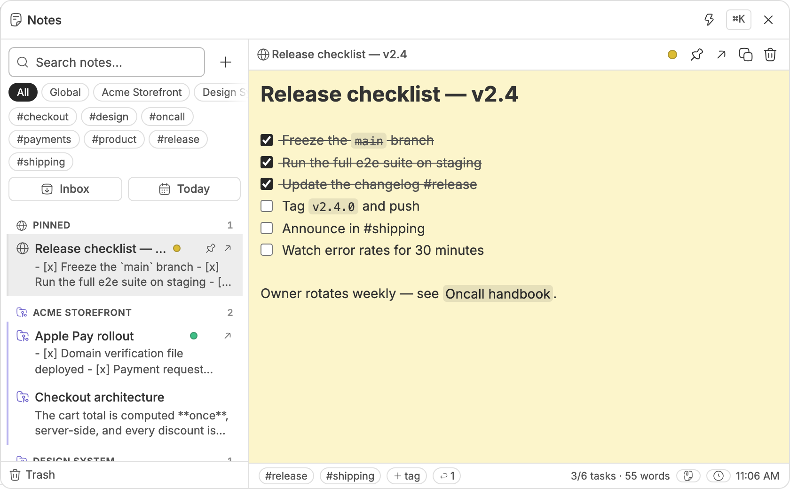
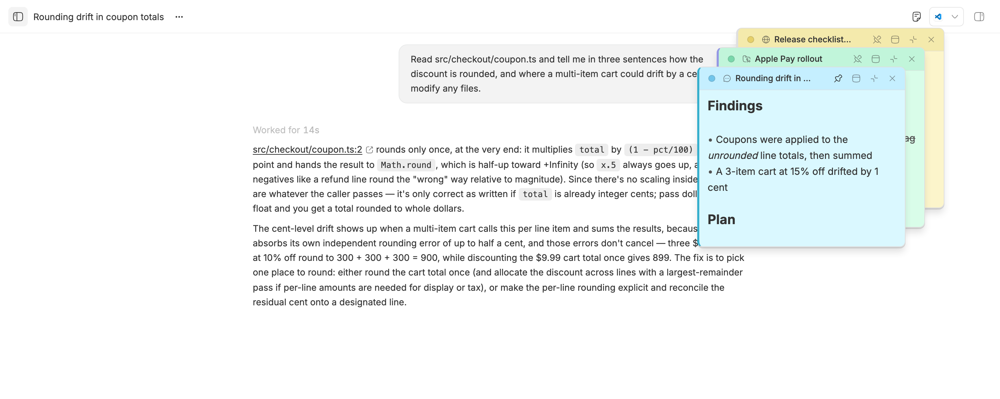
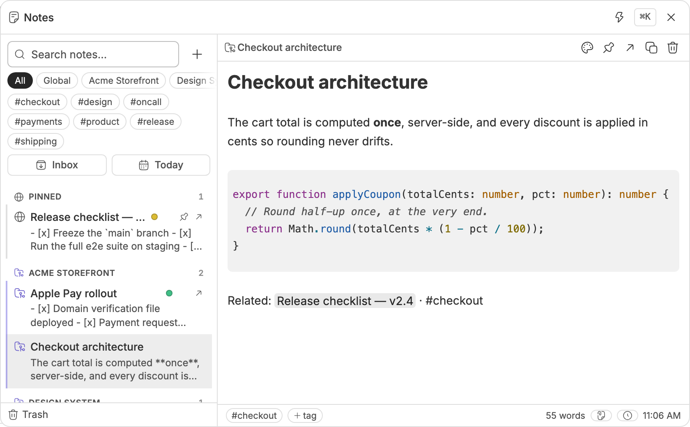
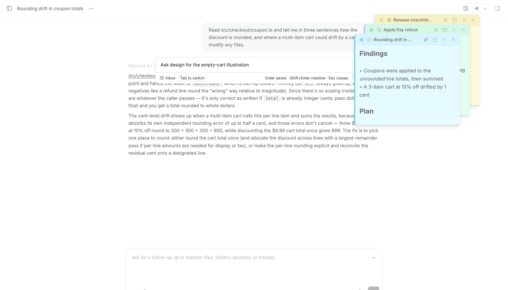
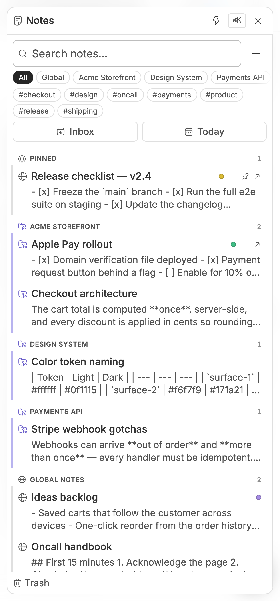
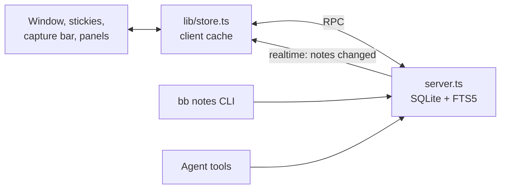

<h1 align="center">Floating Notes</h1>

<p align="center"><b>Sticky notes that float over your agents.</b><br>A notes window one keystroke away, stickies that pin to the thread or project they belong to,<br>a scratchpad for every conversation, and a markdown editor that behaves like one.</p>

<p align="center">
<a href="https://github.com/vburojevic/bb-plugin-floating-notes/releases/latest"></a>

<a href="LICENSE"></a>
<a href="https://github.com/get-bb/marketplace"></a>
</p>

<picture>
  <source media="(prefers-color-scheme: dark)" srcset="https://raw.githubusercontent.com/vburojevic/bb-plugin-floating-notes/main/docs/media/dark/hero.png">
  
</picture>

<p align="center"><sub>One window, three stickies, and the thread you are actually working on.</sub></p>

## Install

Floating Notes is listed in the [BB Community marketplace](https://github.com/get-bb/marketplace), so bb installs it by name:

```sh
bb plugin install floating-notes
```

Or install it straight from this repository:

```sh
bb plugin install git:https://github.com/vburojevic/bb-plugin-floating-notes
```

> [!TIP]
> Press <kbd>Ctrl</kbd> <kbd>'</kbd> anywhere in bb to open the notes window, or <kbd>Ctrl</kbd> <kbd>Shift</kbd> <kbd>'</kbd> to jot one line without leaving the thread.

> [!NOTE]
> Requires bb 0.49 or newer. No account, no API key, nothing leaves your machine: notes live in a SQLite database inside bb's own data directory.

## What it does

<table>
<tr>
<td width="50%" valign="top">

<picture>
  <source media="(prefers-color-scheme: dark)" srcset="https://raw.githubusercontent.com/vburojevic/bb-plugin-floating-notes/main/docs/media/dark/scopes.png">
  
</picture>

### Every note knows where it lives

A flat pile of notes stops being useful at about thirty. The list groups by
**scope** instead: one section per project, by name, then global notes, thread
scratchpads and daily notes. Every row carries a glyph and a tinted left edge
for its scope, and the note's sticky card wears the same color, so a card on
screen and its row in the list read as the same object.

The chips across the top narrow the list to one project, to global notes, or
to threads. Search understands operators too: `tag:api`, `in:scratchpads`,
`is:open`, `thread:current`.

</td>
<td width="50%" valign="top">

<picture>
  <source media="(prefers-color-scheme: dark)" srcset="https://raw.githubusercontent.com/vburojevic/bb-plugin-floating-notes/main/docs/media/dark/stickies.png">
  
</picture>

### Notes that follow the work

Pop any note out as a sticky. Drag it anywhere, snap it to an edge, collapse
it to its title bar, or drop it into **reference mode**: translucent and
click-through until you hover it, so a checklist can sit over an agent's
output without getting in the way.

A sticky can **pin to a thread** or to a **whole project**, and then it only
appears while you are looking at that work. Every thread also gets a
scratchpad, reachable from the thread header and the thread's side panel,
that agents can append to while they work.

</td>
</tr>
<tr>
<td width="50%" valign="top">

<picture>
  <source media="(prefers-color-scheme: dark)" srcset="https://raw.githubusercontent.com/vburojevic/bb-plugin-floating-notes/main/docs/media/dark/editor.png">
  
</picture>

### A real markdown editor

Formatting marks hide as you leave a line. Headings size themselves,
checkboxes are clickable and roll up into a progress ring on the row, code
fences get real syntax highlighting from your bb theme, and tables stay
readable. `[[Wiki links]]` autocomplete across your notes: follow one to a
note that does not exist and it gets created. Paste an image and it is stored
with the note. Type `#tag` anywhere and it becomes a filterable tag.

Edits keep a revision history you can restore from the footer, trash holds
deleted notes for 30 days, and images that lose their last reference are
collected automatically.

</td>
<td width="50%" valign="top">

<picture>
  <source media="(prefers-color-scheme: dark)" srcset="https://raw.githubusercontent.com/vburojevic/bb-plugin-floating-notes/main/docs/media/dark/capture.png">
  
</picture>

### Capture without leaving the thread

<kbd>Ctrl</kbd> <kbd>Shift</kbd> <kbd>'</kbd> opens a one-line bar over
whatever you are doing. Type, press <kbd>Enter</kbd>, and it is saved and
gone. <kbd>Tab</kbd> switches between your Inbox and the current thread's
scratchpad.

From the timeline, **Save as note** keeps a message or a selection with a
link back to the conversation it came from. The composer's **+** menu inserts
a note into the draft, and `@note` mentions resolve fresh at send time.

</td>
</tr>
</table>

### On a phone it becomes a sheet

<table>
<tr>
<td width="50%" valign="top">

<picture>
  <source media="(prefers-color-scheme: dark)" srcset="https://raw.githubusercontent.com/vburojevic/bb-plugin-floating-notes/main/docs/media/dark/mobile.png">
  
</picture>

</td>
<td width="50%" valign="top">

Below bb's compact breakpoint the window stops pretending to be a window: it
fills the viewport minus one even inset, measured from the safe area, and
tracks `visualViewport` so the software keyboard never covers what you are
typing.

Stickies are a desktop surface. On a phone, every note is one tap away inside
the sheet instead.

</td>
</tr>
</table>

## Keyboard

| Shortcut | What it does |
| --- | --- |
| <kbd>Ctrl</kbd> <kbd>'</kbd> | Toggle the notes window |
| <kbd>Ctrl</kbd> <kbd>Shift</kbd> <kbd>'</kbd> | Quick capture |
| <kbd>⌘</kbd> <kbd>K</kbd> | Command palette, inside the window |
| <kbd>⌘</kbd> <kbd>N</kbd> | New note |
| <kbd>⌘</kbd> <kbd>F</kbd> | Jump to search |
| <kbd>⌘</kbd> <kbd>B</kbd>, <kbd>⌘</kbd> <kbd>I</kbd>, <kbd>⌘</kbd> <kbd>⇧</kbd> <kbd>X</kbd> | Bold, italic, strikethrough |
| <kbd>⌘</kbd> <kbd>⇧</kbd> <kbd>K</kbd> | Insert a link |

## Agents and the command line

Five tools let an agent keep notes current while it works, so findings land
on the pad you are already watching. The `bb notes` command covers the same
ground from a shell.

<details>
<summary><b>Agent tools</b></summary>

| Tool | What it does |
| --- | --- |
| `notes_search` | Search your notes, or list recent ones when no query is given |
| `notes_read` | Read one note in full by id (unique id prefixes work) |
| `notes_write` | Create a note, or replace, append to, retag or pin an existing one |
| `notes_trash` | Move a note to the trash, where it stays recoverable |
| `notes_scratchpad` | Read a thread's scratchpad or append to it (the current thread by default) |

</details>

<details>
<summary><b>CLI</b></summary>

```sh
bb notes list                  # every note, newest first
bb notes search "coupon"       # full-text search
bb notes add "Ship the v2.4 announcement"
bb notes scratchpad <thread>   # read or append a thread's pad
bb notes export ./notes-backup # markdown files with front matter
bb notes import ./notes-backup
```

The full set: `list`, `search`, `show`, `add`, `append`, `tag`, `pin`,
`trash`, `restore`, `purge`, `empty-trash`, `daily`, `scratchpad`, `export`
and `import`. Run `bb notes --help` for usage.

</details>

## Settings

<details>
<summary><b>Settings → Plugins → Floating Notes</b></summary>

| Setting | Default |
| --- | --- |
| Toggle window with <kbd>Ctrl</kbd> <kbd>'</kbd> | On |
| Quick capture with <kbd>Ctrl</kbd> <kbd>Shift</kbd> <kbd>'</kbd> | On |
| Editor font size (12, 13, 14 or 16) | 14 |
| Default sticky color | None |
| Quick capture target (Inbox or the current thread's scratchpad) | Inbox |

</details>

## How it fits together

<details>
<summary><b>Architecture and files</b></summary>



```
app.tsx                       registrations: content script, app overlay bridge,
                              sidebar button, scratchpad header button, nav panel,
                              thread tab, message action, composer menu
lib/contract.ts               the RPC contract, shared by server and app
server.ts                     SQLite + FTS5, RPC, mentions, CLI, agent tools
lib/scope.ts                  where a note lives: grouping and filtering
lib/store.ts                  one client cache for every surface
lib/frame.ts                  drag, resize, clamp and persistence for N windows
lib/editor/                   the CodeMirror 6 live-markdown editor
components/floating-notes.tsx the content-script root
```

> [!IMPORTANT]
> Four things worth knowing before changing it:
>
> - **There is no bb React context in the content script.** `lib/rpc.ts` speaks the plugin RPC wire format directly, typed off the same contract. An app overlay in `app.tsx` relays bb's realtime signal and navigation to it.
> - **The server owns the notes; the client caches.** Every surface renders from `lib/store.ts` and mutates through it. Server mutations run behind a mutex.
> - **Theme-aware color is `light-dark()` or bb tokens only.** This plugin's Tailwind build has no `.dark` variant wired to bb's theme.
> - **Do not trust a Tailwind utility bb does not use itself.** Our utilities compile into `@layer utilities`, and layered CSS loses to bb's unlayered app CSS. `w-60` once computed to the container width and pushed the whole editor off-screen; `size-2.5` collapsed a color swatch to a 2px speck. Anything load-bearing lives in `styles.css` under an unlayered `.bb-fn-*` class. Measure the computed value in the running app rather than trusting the class.

</details>

## Development

```sh
npm install
npm run typecheck
npm test
bb plugin build
bb plugin dev      # watch: rebuild and reload on every save
```

## License

[MIT](LICENSE)
